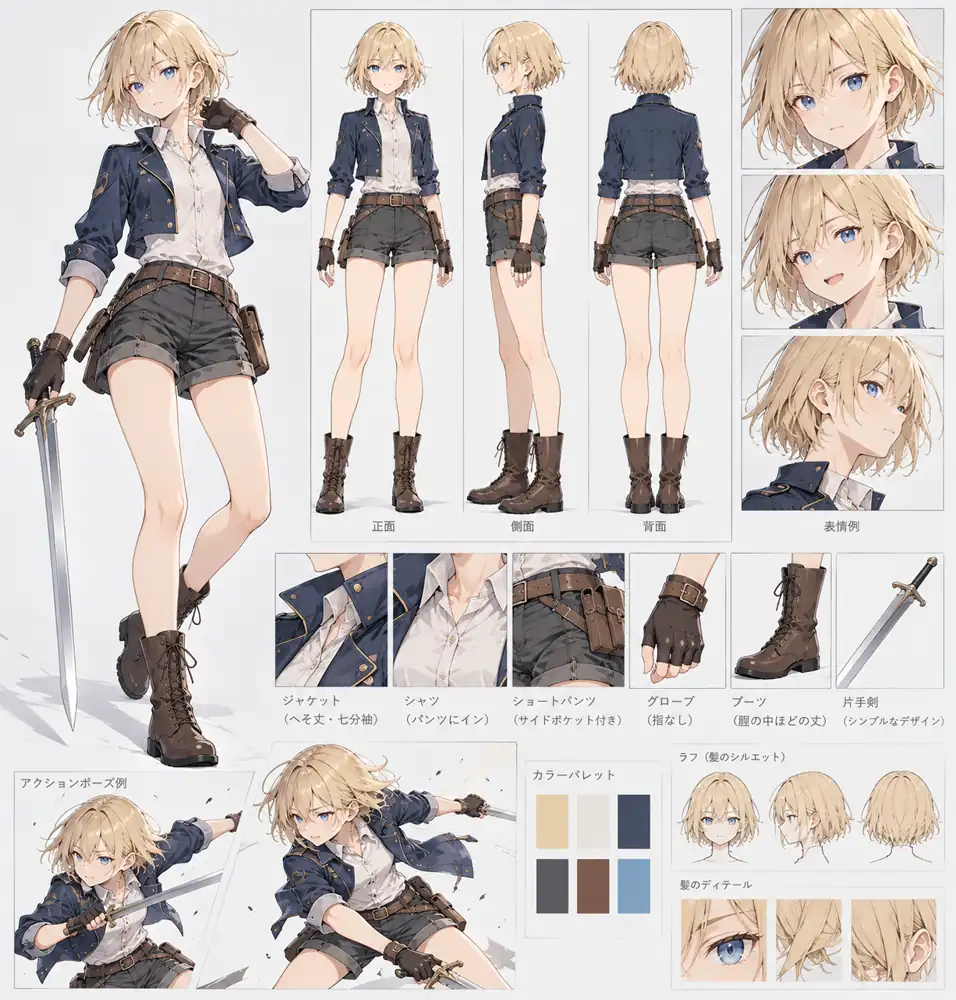
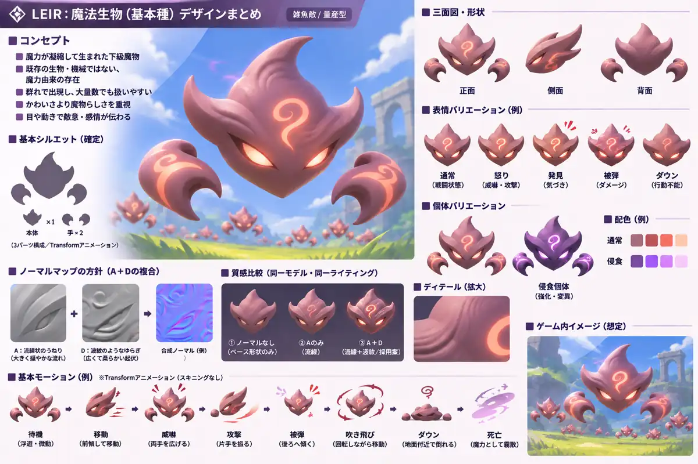

# キャラクター・ビジュアル仕様

状態: リアの基本外見は**確定**。基本雑魚のデザインは**仮ロック**。質感・ライティング・実機表現は**調整中**。

このファイルは**造形・配色・参考画像**の正本。敵AI・被弾などの正本は [Enemies.md](Enemies.md)、リアの戦闘は [Combat.md](Combat.md)。

## 共通アート方針【方針確定】

- 王道ファンタジーの柔らかいアニメ調3D。**ドラクエXIと最近のカービィ**の分かりやすい造形と柔らかな陰影を基本に、**リリンク**のファンタジーらしい材質感を少し取り入れる。
- PBRを基礎に、過剰な写実・強いセル段階化を避ける。描き込みより**シルエットと色面**を重視する。
- 主要色は2〜3色程度。発光は必要な部位だけ。PBR／Soft Ramp／Stylized Diffuse等の差し替え・比較を行い、陰影モデルは実機で決定する。
- 添付画像は**AI生成のコンセプトラフ**で、3Dの造形・マテリアル数値や完成画面を保証するものではない。

## CHAR-001: リア / Leir【基本外見確定】

- 女性寄りで中性的な若い冒険者。7〜8頭身程度。
- 金髪の外ハネショートボブと青い瞳。
- ネイビーの短丈ジャケット（七分袖）、白いシャツ、ダークグレーのショートパンツ、茶色の編み上げブーツ。
- 片手剣で俊敏に戦う。露出や装飾過多を避け、長い髪・マントなどの大きな揺れ物は使わない。
- 上記は**外見参照**。3D生成用の武器なしTポーズは別資料とする。

## CHAR-ENEMY-001: 雑魚魔法生物【デザイン仮ロック】

### コンセプト・構造

- 魔力が凝縮して生まれた意思ある下級魔物。既存の人・獣・機械ではない独自の姿。
- かわいさより**魔物らしい敵意**。鋭い目で感情を伝えるが、**口はない**。
- **本体1メッシュ＋左右の独立した浮遊する爪2つ**。足はない。基本はTransformアニメーションで動かす。
- 上部の尖り、左右の角、爪の**外側シルエットを維持**し、長い炎・煙状の頭頂の揺らぎは作らない。
- 装甲板、岩の割れ目、面ごとの稜線は排し、内側は**連続した滑らかな曲面**。先端の鋭さは残す。

### 配色・個体差

| 個体 | 本体 | 目と魔力紋様 | 発光 |
| --- | --- | --- | --- |
| 通常 | 赤みのある灰色・ローズグレー | 朱色～赤橙色 | 目・紋様の局所Emission |
| 侵食 | 灰紫〜紫系リカラー | 紫系 | 目・紋様の局所Emission |

- 通常個体を作り、侵食個体は**同じ形状・モーションのリカラー**から始める。攻撃性能の差別化は未決定。
- 紋様は大きく**流れる曲線**。魔法陣、文字、刻印のような装飾にしない。
- 全身が光ることはない。主要色は2〜3色程度に抑える。

### 外皮・シェーダー【実機調整】

- 石の塊ではなく、**少し希薄な実体を持つ凝固魔力の外皮**を表現する。
- 基本は**不透明**で、滑らかな曲面・柔らかい陰影・弱く広いハイライト。
- Normal Mapは **A：流線状のうねり＋D：波紋・脈動状の起伏**を弱めに組み合わせる方針。岩肌や規則的な鱗にはしない。
- **リムライトは一旦なし**。**Emissionは目・魔力紋様だけ**。強さ、Roughness、Ramp等は実機比較で調整。

### モーションの方向性【仮】

- 待機: 小さく浮遊。移動: 前傾して滑る。威嚇: 左右の爪を開く。
- 攻撃: 爪で叩く・本体で体当たりする案。詳細は未決定。
- 軽ノックバック: 身体を傾ける。吹き飛び: 全体を回転させて移動。ダウン: 地面付近で停止。
- 死亡: 魔力に分解・霧散する演出を候補とする。具体的な時間・数値・効果は未決定。

## 画像素材

- [リア立ち絵](../Assets/leir_portrait.webp) / [リアのキャラクターシート](../Assets/leir.webp)
- [雑魚敵立ち絵](../Assets/magic_minion_portrait.webp) / [雑魚敵キャラクターシート](../Assets/magic_minion.webp)
- Assets/ はWiki用に最適化したWebP参照版。高画質の元画像とは区別する。
- 単一HTMLを生成する際には画像を**埋め込み**、オフラインで閲覧できるようにする。
